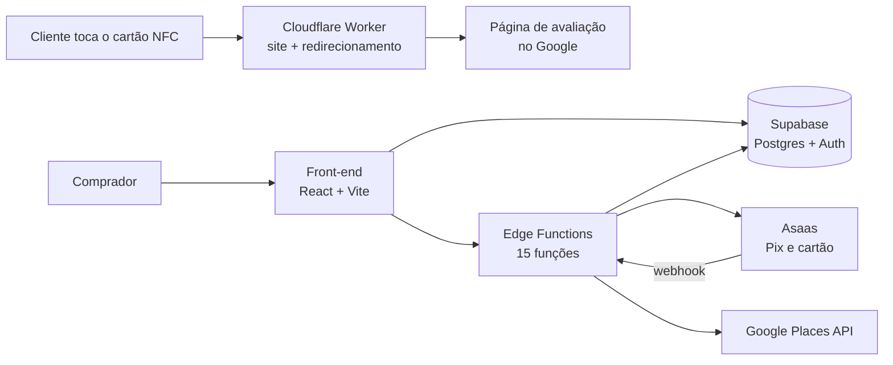

# Aprovacard

**Cartão NFC que leva o cliente direto para a avaliação da empresa no Google.** O cliente aproxima o celular do cartão e a página de avaliação abre na hora, sem app e sem digitar nada.

🌐 **No ar:** [aprovacard.com](https://aprovacard.com/)

> 🔒 O código-fonte é privado, porque é um produto comercial em produção. Este repositório mostra o que o sistema faz e como ele foi construído.

## O que o sistema faz

- **Redirecionamento NFC → Google:** cada cartão tem um link próprio que leva à página de avaliação da empresa, com registro de cada toque.
- **Busca da empresa no checkout:** o cliente encontra o próprio negócio pelo Google Maps/Places, e o cartão já sai configurado.
- **Pagamento com Pix e cartão de crédito** via Asaas, com confirmação automática por webhook.
- **Assinatura opcional** (Relatório Mensal de Evolução), com cancelamento feito pelo próprio cliente.
- **Área do cliente:** pedidos, configurações e acompanhamento.
- **Painel administrativo:** relatórios em PDF, pedidos e um CRM interno para acompanhar a carteira de clientes.
- **Evolução das notas no Google:** sincronização periódica da avaliação de cada empresa.
- **LGPD:** analytics (Google Analytics e Microsoft Clarity) só liga com consentimento (Consent Mode v2).
- **PWA:** instalável no celular.

## Telas

| Checkout | Página "O que é NFC" |
| --- | --- |
|  |  |

## Arquitetura

- **Front-end:** React + TypeScript + Vite, Tailwind CSS e shadcn/ui (Radix), animações com Framer Motion e GSAP
- **Back-end:** Supabase (Postgres, Auth e Row Level Security) com 15 Edge Functions e 48 migrations versionadas
- **Pagamentos:** Asaas (Pix, cartão de crédito e assinatura recorrente)
- **Integrações:** Google Maps JavaScript API e Places
- **Deploy:** Cloudflare Workers
- **Qualidade:** testes com Vitest e Testing Library, mais testes ponta a ponta do fluxo de avaliação

## Stack

       

## Autor

Desenvolvido por **Matheus Ferraz**: [perfil no GitHub](https://github.com/27r6tr592n-prog) · [Instagram](https://www.instagram.com/m.moreira071)
